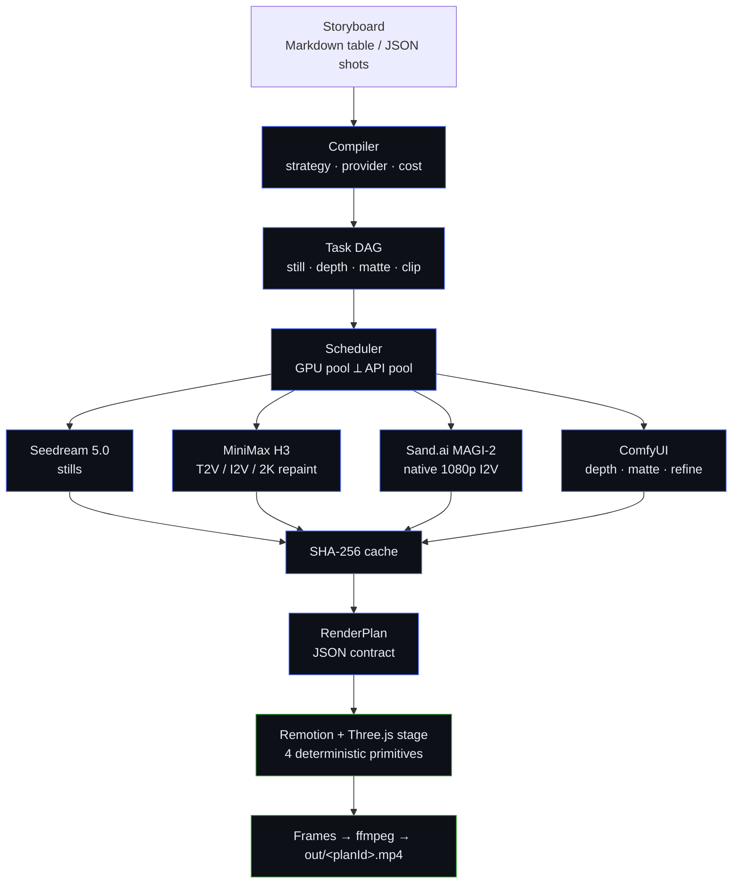

# Video Forge

**A style-agnostic AI video pipeline for [DeepSeek Harness](https://github.com/deepseek-ai): storyboard in, frame-exact footage out — no GPU required, no style baked in.**

[English](README.md) | [简体中文](README.zh-CN.md)

[](LICENSE)
[](../../actions/workflows/ci.yml)
[](#engineering-gates)
[](https://www.remotion.dev/)
[](https://threejs.org/)
[](docs/architecture.md)

[](https://github.com/jlnkx5200-beep/dsh-video-forge/releases/download/v0.1.0/hero-oriental-ink-15s.mp4)

<p align="center">
  <a href="https://github.com/jlnkx5200-beep/dsh-video-forge/releases/download/v0.1.0/hero-oriental-ink-15s.mp4"></a>
  <br /><sub><b>墨卷山河 · Ink Scroll</b> — 15 s · 1920×1080 · 30 fps.
  Three shots, one storyboard, <b>&lt; ¥5 of API spend</b>: Seedream stills on real ComfyUI depth maps,
  one MiniMax H3 2K repaint, three deterministic Three.js camera moves.
  <a href="https://github.com/jlnkx5200-beep/dsh-video-forge/releases/download/v0.1.0/hero-oriental-ink-15s.mp4"><b>▶ Watch the 1080p cut</b></a> ·
  <a href="docs/media/hero-oriental-ink-poster.png">poster</a></sub>
</p>

---

## Why Video Forge

### 1. The kernel has no style. Presets do.

The renderer exposes exactly four deterministic primitives — depth parallax, spatial stills,
video layers, and compositing — and every aesthetic decision arrives as data through a
`StyleSpec`. Six presets ship (`cinematic-realism`, `editorial-minimal`, `anime-atmospheric`,
`cyber-neon`, `oriental-ink`, `video-first`), and switching between them changes the look
without touching a line of engine code. Golden-frame diffs are exact:

```
$ node scripts/check-frames.mjs
frame 0   maxDiff=0   frame 24   maxDiff=0
```

Style-agnosticism is enforced, not promised: `src/core/**` (providers, scheduler, cache) is
scanned by the quality gate for three.js, camera and style vocabulary.

### 2. Two video engines, routed per shot

Video generation is not one problem, so the compiler routes each shot to the engine that is
actually good at it.

| | **MiniMax H3** | **Sand.ai MAGI-2** |
| --- | --- | --- |
| Strength | text-to-video, UI/layout motion, cheap drafts | native 1080p image-to-video, real 4–30 s shots |
| Resolutions | 480P / 768P / 2K | native 1080p |
| References | first frame | up to 20 images, flat price |
| In this pipeline | `minimax-direct`, `minimax-2k-repaint` | `magi2-direct`, `magi2-i2v` |

`minimax-2k-repaint` exists because H3 tops out at 768P: Video Forge renders a still, feeds it
back as the first frame and asks H3 for a 2K take, so sharpening happens inside the model
instead of in ffmpeg.

> **Honest status — MAGI-2 is waiting for quota.** The integration, the request contract, the
> payload sanitizer and their tests are complete and merged; the Sand.ai account behind them
> has not been granted generation quota yet. Until it is, MAGI-2 shots report `pending_quota`
> (distinguished from `invalid_key` by `POST /magi2/probe`) and replay a draft take, so plans
> still complete end to end. Everything else in this README runs today.

### 3. Built for an 8 GB consumer GPU

- **Split concurrency pools** — ComfyUI (local GPU) and the remote APIs are scheduled
  independently, so a saturated GPU never blocks a Seedream call.
- **Content-addressed cache** — every still, depth map, matte and clip is keyed by
  `sha256(provider + model + prompt + params)`; retries and re-renders are free.
- **Explicit degradation** — `production` mode refuses fake depth or fake mattes instead of
  quietly shipping a worse frame; `draft` mode is where cheap approximations are allowed.
- **ComfyUI custom nodes** — eight nodes for depth, normals, matting, tiling, inspection,
  template injection, host callbacks and workflow manifests.

---

## Architecture



Host (`src/`) and renderer (`remotion/src/`) are hard-separated: the host never imports
three.js or speaks camera language, the renderer never sees an API key or dispatches a
provider. The only thing that crosses the boundary is a `RenderPlan`. Details in
[`docs/architecture.md`](docs/architecture.md).

---

## 3-Minute Quick Start

### Step 1 — Prove the pipeline works, spending nothing

No API key, no GPU, no ComfyUI. The mock provider exercises compile → schedule → cache →
`RenderPlan` → render.

```bash
git clone https://github.com/jlnkx5200-beep/dsh-video-forge.git
cd dsh-video-forge
npm install          # pulls host peer types + tsdown, no DSH checkout needed
npm run build
node scripts/qa-mock.mjs        # 4 shots, 1080p, keyless end to end
```

The mock providers write deterministic fixtures through the *real* compiler, scheduler and
cache, then emit a `RenderPlan` — the JSON that drives rendering — and print a per-task
report. Assets go to a temporary forge home; pass `VF_HOME=./out/qa` to keep them. Add
`--strategy=still-3d` to exercise another path. To see pixels, pipe that plan into the
renderer:

```bash
node remotion/scripts/still.mjs <planPath> 24 out/cover.png
node remotion/scripts/render.mjs <planPath> out/clip.mp4
```

### Step 2 — Install the plugin into DeepSeek Harness

```bash
git clone https://github.com/jlnkx5200-beep/dsh-video-forge.git \
  <WORKSPACE>/plugins/dsh-video-forge
cd <WORKSPACE>/plugins/dsh-video-forge
npm install && npm run build
```

Then, in a DSH session that has the plugin injector:

```text
dev_inject_plugin({ dir: '<WORKSPACE>/plugins/dsh-video-forge' })
```

Alternatively add `@dsh-external/dsh-video-forge` to your profile's `bundles` list and restart
DSH. The console appears as a **Video Forge** panel with four tabs: Compose / Jobs / Plans /
Settings.

> Host-side types come from the published `@deepseek-ai/*` packages. If you want the build to
> use your own DSH source tree instead, set `DSH_CHECKOUT=/path/to/deepseek-harness` — the
> build script picks it up automatically.

### Step 3 — Add keys (only what you will use)

| Provider | Variable | Needed for |
| --- | --- | --- |
| Seedream / Ark | `ARK_API_KEY` | stills (every strategy except pure T2V) |
| MiniMax | `MINIMAX_API_KEY` | `minimax-direct`, `minimax-2k-repaint`, `comfy-pipeline` |
| Sand.ai | `SAND_API_KEY` | `magi2-direct`, `magi2-i2v` |
| ComfyUI | — | optional, `http://127.0.0.1:8188` |

Interactive, masked, written to `~/.dsh/video-forge.json`:

```bash
node scripts/set-keys.mjs
```

or use **Settings** in the console, or plain environment variables. Keys are never echoed and
`GET /status` only returns masked forms.

### Step 4 — Produce something real

Ask the agent:

```text
video_forge_produce({
  title: 'Mechanical keyboard — launch teaser',
  preset: 'cinematic-realism',
  shots: [
    { id: 's1', shot: 'extreme close-up', durationSec: 5, move: 'dolly-in',
      strategy: 'still-3d',
      prompt: 'macro shot of the aluminium frame, cool rim light, shallow depth of field' },
    { id: 's2', shot: 'close-up', durationSec: 4,
      strategy: 'minimax-2k-repaint',
      prompt: 'keycaps ripple like water as a backlight sweeps across them' }
  ]
})
```

or paste a Markdown storyboard into the **Compose** tab. Both paths compile to the same
`RenderPlan`; the console shows a per-shot cost estimate before you spend anything.

---

## Engineering Gates

Every claim above is backed by a command that fails loudly. All eight run without API keys.

| # | Gate | Command | Scope |
| --- | --- | --- | --- |
| 1 | Build | `bash scripts/build.sh` | host `tsc` + client bundle (checks DSH checkout, falls back to npm) |
| 2 | Renderer types | `cd remotion && npx tsc -p tsconfig.json --noEmit` | the whole stage, strict |
| 3 | Plan contract | `node scripts/check-plan.mjs --all` | every fixture and preset is schema-valid |
| 4 | Visual red lines | `node scripts/check-quality.mjs` | six dimensions per preset, no fake algorithms |
| 5 | Golden frames | `node scripts/check-frames.mjs` | re-render is bit-stable (`maxDiff = 0`) |
| 6 | Node tests | `npm test` | 41 cases: contracts, cache, scheduler, providers, plan parsing |
| 7 | Python nodes | `bash comfyui-nodes/dsh-video-assets/tests/run_checks.sh` | 50 cases: 8 nodes, tensor ops, HTTP bridge |
| 8 | Hygiene | `node scripts/check-hygiene.mjs` | no secrets, no machine paths, no blob > 5 MB |

**Tests: 41 node + 50 Python.** The visual half cannot be automated, so it is a written
process instead: [`docs/visual-quality-standard.md`](docs/visual-quality-standard.md) defines
the five-point review, and [`docs/visual-qa-log.md`](docs/visual-qa-log.md) records every round
with frames, scores, defects and fixes. `AGENTS.md` makes that loop mandatory for anyone —
human or agent — touching rendering code.

CI runs the keyless subset on `ubuntu-latest` with no GPU and no secrets:
[`.github/workflows/ci.yml`](.github/workflows/ci.yml).

---

## Roadmap

Honest, in rough priority order:

- **MAGI-2 real-machine regression** — once quota is granted: T2V, I2V, first/last frame,
  multi-reference limits and 30 s takes, each with a committed plan, footage and cost note.
- **Planned audio bed** — audio from generated clips already survives the render, and
  `RenderPlan.audio` (`src` / `volume` / `beats`) is in the contract, but no scene consumes it
  yet. Wiring it to an `<Audio>` layer plus beat-synced cuts is the next audio step.
- **Real depth model by default** — the bundled path already refuses to fake depth in
  `production`; the next step is making a strong depth model the out-of-the-box default.
- **25 fps previs export** — an editorial cut with burn-ins, for reviewing pacing before
  committing to final renders.
- **Preset authoring guide** — a documented, testable workflow for third-party presets.

---

## Documentation

| | |
| --- | --- |
| [Architecture](docs/architecture.md) | contracts, providers, cache, control plane, isolation rules |
| [Visual quality standard](docs/visual-quality-standard.md) | red lines, six dimensions, mandatory QA loop (Chinese) |
| [Visual QA log](docs/visual-qa-log.md) | per-round evidence (Chinese) |
| [Media kit](docs/media/README.md) | every demo asset, its size budget and regeneration command |
| [AGENTS.md](AGENTS.md) | hard rules for contributors and coding agents (Chinese) |
| [CHANGELOG.md](CHANGELOG.md) | what changed, and what is deliberately not done yet |

## License

[MIT](LICENSE) © dsh-video-forge contributors.

Bundled dependencies keep their own licenses: Remotion (company license required for some
uses — check [remotion.dev/license](https://www.remotion.dev/license)), Three.js (MIT),
React (MIT), DeepSeek Harness (`@deepseek-ai/*`, see its repository).
