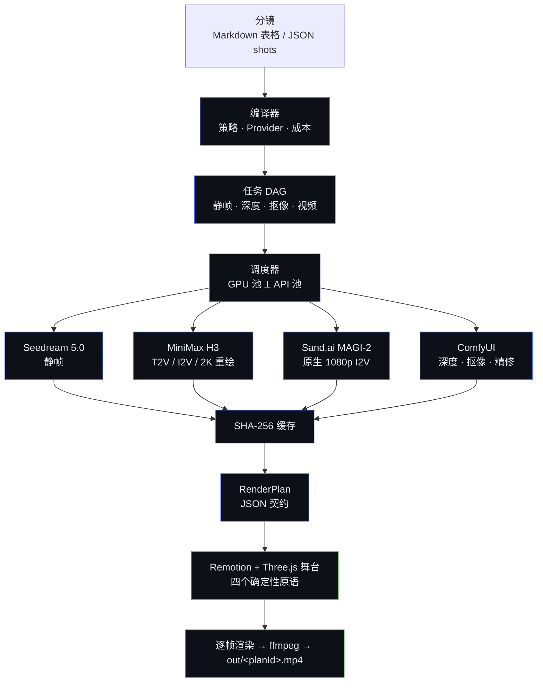

# Video Forge

**面向 [DeepSeek Harness](https://github.com/deepseek-ai) 的风格无关 AI 视频管线：输入分镜，输出帧级可复现的成片 —— 不需要 GPU，也不把任何一种风格焊死在引擎里。**

[English](README.md) | [简体中文](README.zh-CN.md)

[](LICENSE)
[](../../actions/workflows/ci.yml)
[](#工程门禁)
[](https://www.remotion.dev/)
[](https://threejs.org/)
[](docs/architecture.md)

[](https://github.com/jlnkx5200-beep/dsh-video-forge/releases/download/v0.1.0/hero-oriental-ink-15s.mp4)

<p align="center">
  <a href="https://github.com/jlnkx5200-beep/dsh-video-forge/releases/download/v0.1.0/hero-oriental-ink-15s.mp4"></a>
  <br /><sub><b>墨卷山河 · Ink Scroll</b> —— 15 秒 · 1920×1080 · 30fps。一份分镜、三个镜头、<b>总 API 成本 &lt; ¥5</b>：
  Seedream 静帧 + ComfyUI 真实深度图，一段 MiniMax H3 2K 重绘，三段确定性 Three.js 运镜。
  <a href="https://github.com/jlnkx5200-beep/dsh-video-forge/releases/download/v0.1.0/hero-oriental-ink-15s.mp4"><b>▶ 观看 1080p 原片</b></a> ·
  <a href="docs/media/hero-oriental-ink-poster.png">封面帧</a></sub>
</p>

---

## 为什么是 Video Forge

### 1. 内核不含风格，风格由预设注入

渲染侧只提供四个确定性原语 —— 深度视差、空间静帧、视频图层、合成 —— 所有美学决策都以数据形式经
`StyleSpec` 注入。内置六个预设（`cinematic-realism`、`editorial-minimal`、`anime-atmospheric`、
`cyber-neon`、`oriental-ink`、`video-first`），切换它们不需要改引擎代码。黄金帧差分是精确的：

```
$ node scripts/check-frames.mjs
frame 0   maxDiff=0   frame 24   maxDiff=0
```

「风格无关」是被强制执行的，不是口号：质量门禁会扫描 `src/core/**`（providers / scheduler / cache），
出现 three.js、镜头或风格词汇即失败。

### 2. 双视频引擎，按镜头路由

视频生成不是一个问题，所以编译器把每个镜头路由给真正擅长它的引擎。

| | **MiniMax H3** | **Sand.ai MAGI-2** |
| --- | --- | --- |
| 强项 | 文生视频、UI / 版式动效、低价草稿 | 原生 1080p 图生视频、真实 4–30 秒镜头 |
| 分辨率 | 480P / 768P / 2K | 原生 1080p |
| 参考图 | 首帧 | 最多 20 张，不加价 |
| 本管线中的策略 | `minimax-direct`、`minimax-2k-repaint` | `magi2-direct`、`magi2-i2v` |

`minimax-2k-repaint` 的存在理由是 H3 的上限只有 768P：先出一张静帧，把它作为首帧回灌，再让 H3 以 2K
直出——锐化发生在模型里，而不是 ffmpeg 里。

> **诚实的现状 —— MAGI-2 正在等配额。** 接入、请求契约、payload 脱敏器和对应单测都已完成并合入；但
> 背后的 Sand.ai 账号尚未获得生成配额。在此之前，MAGI-2 镜头会如实报 `pending_quota`
> （`POST /magi2/probe` 可把它与 `invalid_key` 区分开），并回放草稿级产物，因此方案仍能端到端跑完。
> 本 README 的其余部分今天就能跑。

### 3. 为 8GB 消费级显卡设计

- **GPU / API 分池并发** —— ComfyUI（本地 GPU）与远端 API 独立调度，GPU 打满不会阻塞 Seedream 调用。
- **内容寻址缓存** —— 每张静帧、深度图、抠像和视频片段都以
  `sha256(provider + model + prompt + params)` 为键；重试与重渲染零成本。
- **显式降级** —— `production` 模式拒绝伪深度、拒绝伪抠像，而不是悄悄交出一帧更差的画面；
  廉价近似只允许出现在 `draft` 模式。
- **ComfyUI 自定义节点** —— 八个节点：深度、法线、抠像、无缝平铺、资产体检、模板注入、宿主回调、工作流清单。

---

## 架构



宿主（`src/`）与渲染侧（`remotion/src/`）硬隔离：宿主永不 import three.js、也不说镜头语言；渲染侧永远看不到
API Key、也不做 Provider 调度。跨边界的只有一份 `RenderPlan`。细节见
[`docs/architecture.md`](docs/architecture.md)。

---

## 3 分钟快速开始

### 第 1 步 —— 零花费验证整条管线

不需要 API Key、不需要 GPU、不需要 ComfyUI。mock provider 会跑完「编译 → 调度 → 缓存 →
`RenderPlan` → 渲染」全程。

```bash
git clone https://github.com/jlnkx5200-beep/dsh-video-forge.git
cd dsh-video-forge
npm install          # 拉取宿主 peer 类型与 tsdown，无需 DSH 源码
npm run build
node scripts/qa-mock.mjs        # 4 个镜头、1080p，端到端零密钥
```

mock provider 走的是**真实**的 compiler / scheduler / cache，产出确定性素材，再输出驱动渲染的
`RenderPlan`，并打印逐任务报告。素材落在临时 forge home；设 `VF_HOME=./out/qa` 可留在仓库内。
加 `--strategy=still-3d` 可以换一条路径再跑。想看像素就把这份 plan 交给渲染脚本：

```bash
node remotion/scripts/still.mjs <planPath> 24 out/cover.png
node remotion/scripts/render.mjs <planPath> out/clip.mp4
```

### 第 2 步 —— 装进 DeepSeek Harness

```bash
git clone https://github.com/jlnkx5200-beep/dsh-video-forge.git \
  <WORKSPACE>/plugins/dsh-video-forge
cd <WORKSPACE>/plugins/dsh-video-forge
npm install && npm run build
```

然后在一个装了插件注入器的 DSH 会话里：

```text
dev_inject_plugin({ dir: '<WORKSPACE>/plugins/dsh-video-forge' })
```

或者把 `@dsh-external/dsh-video-forge` 加进 profile 的 `bundles` 列表并重启 DSH。控制台会以
**Video Forge** 面板出现，四个标签：编排 / 作业 / 方案 / 设置。

> 宿主类型默认取自已发布的 `@deepseek-ai/*` 包。若想让构建改用你自己的 DSH 源码树，设置
> `DSH_CHECKOUT=/path/to/deepseek-harness`，构建脚本会自动切换。

### 第 3 步 —— 录入密钥（用哪个录哪个）

| Provider | 环境变量 | 用于 |
| --- | --- | --- |
| Seedream / Ark | `ARK_API_KEY` | 静帧（除纯 T2V 外的所有策略） |
| MiniMax | `MINIMAX_API_KEY` | `minimax-direct`、`minimax-2k-repaint`、`comfy-pipeline` |
| Sand.ai | `SAND_API_KEY` | `magi2-direct`、`magi2-i2v` |
| ComfyUI | — | 可选，`http://127.0.0.1:8188` |

掩码交互录入，写入 `~/.dsh/video-forge.json`：

```bash
node scripts/set-keys.mjs
```

也可以用控制台 **设置** 页，或直接用环境变量。密钥从不回显，`GET /status` 只返回掩码形态。

### 第 4 步 —— 真的出一条片

对 Agent 说：

```text
video_forge_produce({
  title: '机械键盘 —— 发布预热',
  preset: 'cinematic-realism',
  shots: [
    { id: 's1', shot: '微距', durationSec: 5, move: 'dolly-in',
      strategy: 'still-3d',
      prompt: '铝合金边框微距，冷色轮廓光，浅景深' },
    { id: 's2', shot: '特写', durationSec: 4,
      strategy: 'minimax-2k-repaint',
      prompt: '键帽如水面涟漪，背光扫过' }
  ]
})
```

或者把 Markdown 分镜表粘进 **编排** 标签。两条路径编译出同一份 `RenderPlan`；控制台会在花钱之前
显示逐镜头成本估算。

---

## 工程门禁

上面每一条主张背后都有一个会响亮失败的命令。八道门禁全部无需 API Key。

| # | 门禁 | 命令 | 覆盖范围 |
| --- | --- | --- | --- |
| 1 | 构建 | `bash scripts/build.sh` | 宿主 `tsc` + client 打包（优先 DSH checkout，回退 npm） |
| 2 | 渲染侧类型 | `cd remotion && npx tsc -p tsconfig.json --noEmit` | 整个舞台，strict |
| 3 | 方案契约 | `node scripts/check-plan.mjs --all` | 所有 fixture 与预设都通过 schema |
| 4 | 画质红线 | `node scripts/check-quality.mjs` | 每个预设六维度显式声明、禁止伪算法 |
| 5 | 黄金帧 | `node scripts/check-frames.mjs` | 重渲染比特级稳定（`maxDiff = 0`） |
| 6 | Node 单测 | `npm test` | 41 条：契约、缓存、调度、Provider、方案解析 |
| 7 | Python 节点 | `bash comfyui-nodes/dsh-video-assets/tests/run_checks.sh` | 50 条：8 节点、张量、HTTP 桥 |
| 8 | 仓库体检 | `node scripts/check-hygiene.mjs` | 无密钥、无本机路径、无 > 5 MB 文件 |

**测试：41 条 Node + 50 条 Python。** 视觉这一半无法自动判定，所以它是写下来的流程而不是脚本：
[`docs/visual-quality-standard.md`](docs/visual-quality-standard.md) 定义五维复核清单，
[`docs/visual-qa-log.md`](docs/visual-qa-log.md) 逐轮记录帧、评分、缺陷与修复。`AGENTS.md` 使这套流程
对任何改动渲染代码的人（或 agent）成为强制项。

CI 在 `ubuntu-latest` 上零密钥、零 GPU 跑通上面无需密钥的部分：
[`.github/workflows/ci.yml`](.github/workflows/ci.yml)。

---

## 路线图

诚实列出，大致按优先级：

- **MAGI-2 真机回归** —— 配额到位后跑 T2V、I2V、首尾帧、多参考上限与 30 秒镜头，每项都留下 plan、
  成片与成本记录。
- **计划式音轨** —— 生成片源自带的声音已能穿过渲染保留下来；`RenderPlan.audio`（`src`/`volume`/`beats`）
  已在契约里，但还没有任何场景消费它。下一步是接上 `<Audio>` 图层并做节拍对齐剪辑。
- **默认接入真深度模型** —— 现有路径在 `production` 下已拒绝伪深度；下一步是让强深度模型成为开箱默认。
- **25fps Previs 导流** —— 带烧字的剪辑版，用于在最终渲染前审节奏。
- **预设编写指南** —— 给第三方预设一套可文档化、可测试的流程。

---

## 文档

| | |
| --- | --- |
| [架构](docs/architecture.md) | 契约、Provider、缓存、控制面、隔离铁律 |
| [视觉质量标准](docs/visual-quality-standard.md) | 红线、六维预设、强制 Visual QA Loop |
| [视觉自检记录](docs/visual-qa-log.md) | 逐轮证据 |
| [素材说明](docs/media/README.md) | 每个演示素材、体积预算与再生成命令 |
| [AGENTS.md](AGENTS.md) | 面向贡献者与编码 agent 的硬性规则 |
| [CHANGELOG.md](CHANGELOG.md) | 改了什么，以及哪些是刻意还没做的 |

## 许可证

[MIT](LICENSE) © dsh-video-forge contributors。

随附依赖各自保留其许可证：Remotion（部分用途需商业授权，见
[remotion.dev/license](https://www.remotion.dev/license)）、Three.js（MIT）、React（MIT）、
DeepSeek Harness（`@deepseek-ai/*`，见其仓库）。
